# Documentación Chrips

La placa de mecanismos RevA Mechanisms 2024 es una placa de circuitos impresa que tiene el propósito de permitirle al barco autónomo poner en actuación una bomba de agua, un motor a prueba de agua y un motor NEMA 23 pertenecientes a un mecanismo recoge y entrega objetos. Cuenta adicionalmente con varios periféricos para la actuación de módulos y actuadores adicionales externos con necesidad de voltaje de alimentación de +3.3V y +5V.

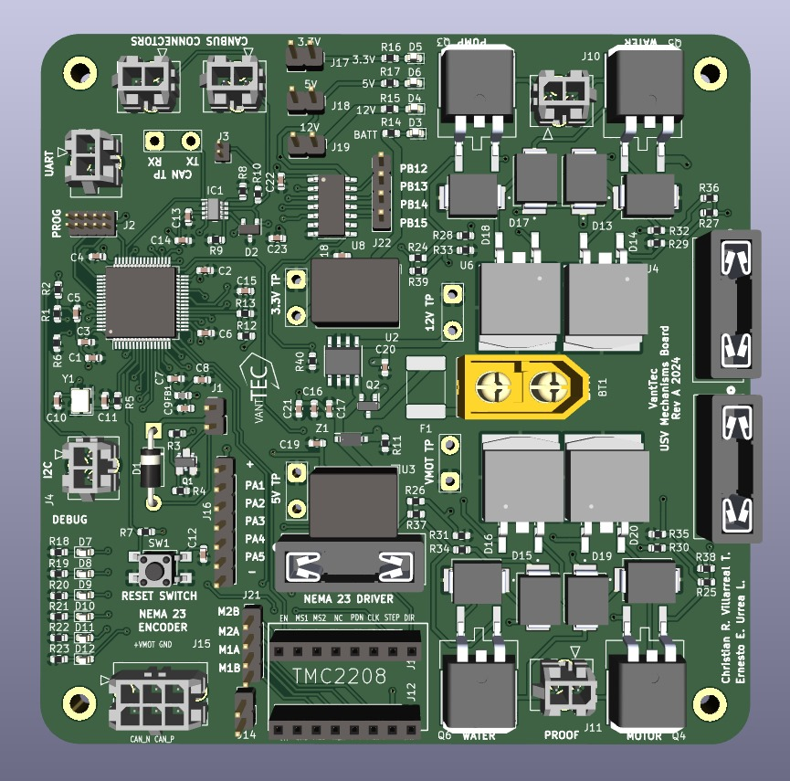

## Diseño de Esquemático

### Página de Raíz

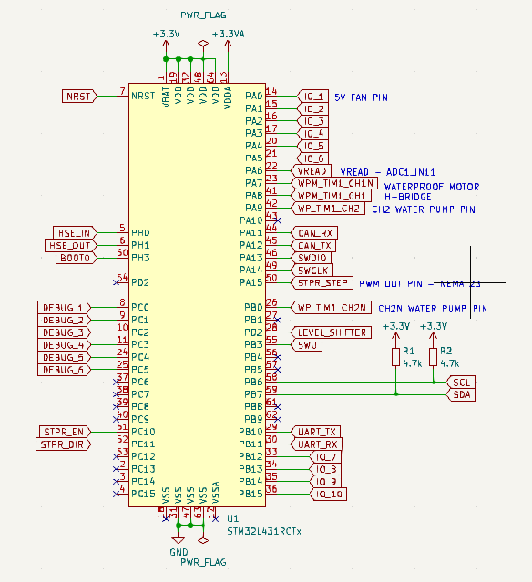

STM32L431RCTx con etiquetas globales, banderas de no conexión, banderas de potencia, resistencias pull-up en las líneas SCL/SDA y descripciones de ciertas etiquetas globales específicas.

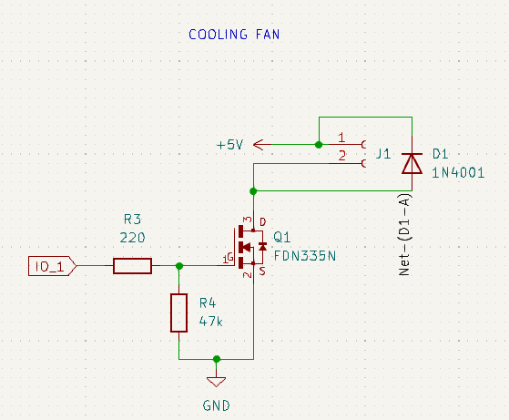

Circuito de ventilador de enfriamiento en donde el transistor FDN335N actúa como interruptor, las resistencias actúan como control estable de la puerta y el diodo 1N4001 protege el circuito de picos de voltaje.

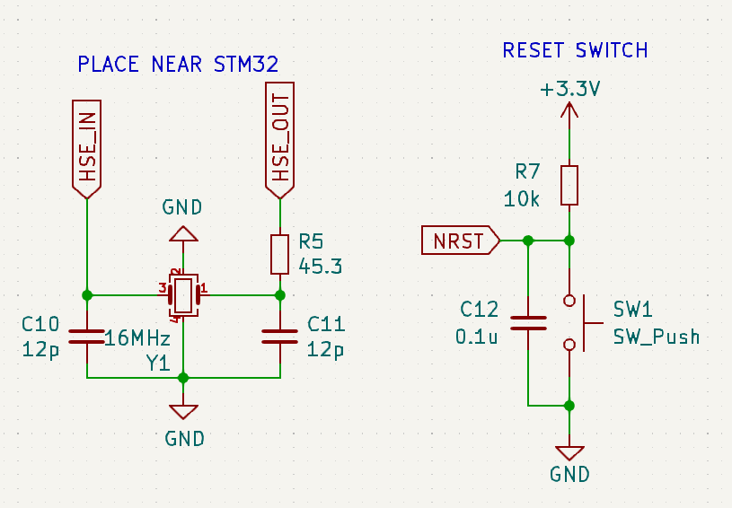

El oscilador de 16 MHz le da al microcontrolador una fuente de reloj externa precisa para mejorar su rendimiento y el switch de reinicio garantiza un reinicio limpio y estable.

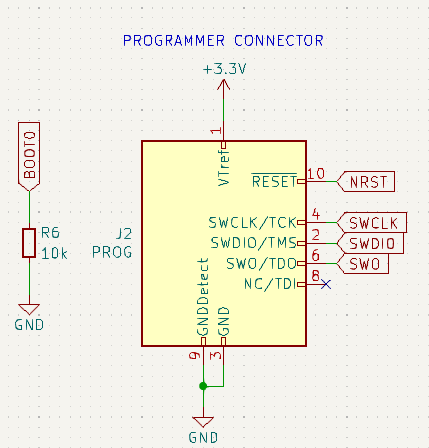

El conector programado es esencial para la programación y depuración del microcontrolador para facilitar la comunicación, control y reinicio. El pin BOOT0 garantiza que el microcontrolador arranque desde la memoria flash interna.

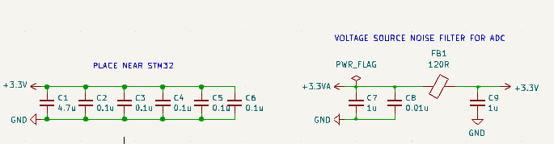

Los capacitores / condensadores de desacoplamiento o bypass colocados cerca de la STM32 utilizados para reducir el ruido y ayudar a crear una señal de corriente continua más limpia y proporcionar energía adecuada.

El root page del proyecto contiene los elementos básicos requeridos por el microcontrolador STM32L431RCTx de la placa impresa de circuitos.

#### STM32L431RCTx

El microcontrolador en la placa de circuitos RevA 2024 Mechanisms tiene el papel de cerebro del sistema. Se encarga de ejecutar las instrucciones en su memoria para controlar el funcionamiento de los dispositivos y circuitos conectados a la PCB.

#### Capacitores / Condensadores de Desacoplamiento o Bypass

Los capacitores / condensadores de desacoplamiento o bypass se colocan cerca de los pines fuentes de energía del microcontrolador para actuar como reservas locales de energía. Cuando el microcontrolador cambia estados rápidamente (e.g., durante procesamiento o comunicación), los cambios repentinos en la extracción de corriente pueden crear fluctuaciones de voltaje en las líneas eléctricas. Los capacitores proveen corriente instantánea para suavizar estas fluctuaciones y mantener un voltaje estable. Los capacitores de 0.1 µF se usan para el desacoplamiento de frecuencias altas y el de 4.7 µF para manejar ruido de baja frecuencia y capacitancia masiva.

Los capacitores conectados con la perla de ferrita conforman un filtro paso bajo que minimiza el ruido de alta frecuencia en la línea eléctrica que alimenta el convertidor ADC. Esto asegura que el voltaje suministrado al ADC sea limpio para conversiones análogas-a-digitales correctas. 

La perla de ferrita actúa para derivar el ruido de alta frecuencia a tierra, lo que lo previene alcanzar el convertidor ADC. El filtro LC combinado ayuda a mantener el voltaje libre de ruido y estable.

#### Oscilador de 16 MHz

El oscilador de 16 MHz proporciona una señal de reloj precisa y estable para el microcontrolador cuando es excitado eléctricamente. Esta señal es necesaria para sincronizar todas las operaciones internas, como la ejecución de instrucciones y la comunicación de periféricos. Aunque algunos microcontroladores tienen osciladores internos, los externos tienen mayor precisión y menor desviación de frecuencia. Los capacitores conectados ayudan a estabilizar la oscilación y ajustar la frecuencia del cristal para mantener su frecuencia nominal. También tiene una resistencia para ajustar su ganancia y asegurar un inicio confiable de su oscilación. 

#### Switch de Reinicio

El switch de reinicio nos permite reiniciar manualmente el microcontrolador. Esto provoca que vuelva a su estado inicial de ejecución y es útil para salir de condiciones de error o de bloqueo. Tiene un resistor pull-up para mantener la línea de reset en un estado conocido cuando el botón no es presionado. El capacitor ayuda a filtrar el ruido y a estabilizar la señal de reset para evitar reinicios no deseados. La combinación del botón y el resistor forman un filtro de debouncing para suavizar pequeñas oscilaciones en la señal del botón al ser presionado por rebotes mecánicos. 

#### Conector Programador y Señal de Boot

El conector programador permite la programación, depuración y reinicio del microcontrolador. Este tienes las siguientes señales para su funcionamiento:

- **NRST (Reset):** Permite que el programador o depurador controle el renicio del microcontrolador sin intervención manual.
- **SWCLK (Serial Wire Clock):** La señal de reloj para sincronizar la transferencia de datos entre el microcontrolador y el programador o depurador como parte de la interfaz de depuración Serial Wire Debug (SWD).
- **SWDIO (Serial Wire Data I/O):** La línea de entrada / salida bidireccional de datos para la comunicación de depuración y programación. Transmite datos y comandos entre el programador y el microcontrolador.
- **SWO (Serial Wire Output):** Línea opcional que se usa para la salida de datos de depuración donde información en tiempo real como mensajes de depuración pueden ser transmitidas hacia el programador o PC.

BOOT0 es un pin de configuración que determina el modo de arranque del microcontrolador. Está conectado a tierra mediante un resistor para que el microcontrolador arranque desde la memoria flash interna en donde se encuentra el firmware programado. Si se conecta a nivel alto (e.g. +3.3V), el microcontrolador arranque en un modo alternativo, como el arranque de la memoria del sistema (bootloader) donde se puede cargar firmware nuevo sin un programador externo. De forma predeterminada, el resistor es un pull-down para que BOOT0 esté en un nivel bajo y la STM32 arranque desde su memoria flash.

#### Ventilador de Enfriamiento

El ventilador se usa para enfriar el sistema y sus reguladores de voltaje y microcontrolador, para evitar el sobrecalentamiento. La señal IO_1 de la STM32 controla si el ventilador está encendido o apagado. El transistor FDN335N es un interruptor electrónico que se activa y permite el paso de corriente cuando la señal IO_1 es alta. La resistencia  en serie con la puerta del transistor limita la corriente hacia el transistor y la resistencia pull-down asegura que la puerta esté en estado bajo cuando IO_1 está apagada. El drenaje del transistor es la ruta de la corriente conectado a una terminal del cabezal y la fuente es conectada a tierra. La otra terminal del transistor es conectada a +5V. Cuando el ventilador se apaga, la energía almacenada en la bobina del motor del ventilador genera un pico de voltaje inverso y el diodo proporciona un camino para la corriente resultante para que no se dañe el transistor ni el microcontrolador.

### Página de Comunicaciones

El transceptor MAX33040E convierte las señales digitales del microcontrolador a niveles diferenciales de las líneas CANH y CANL para la comunicación con el bus CAN. Los componentes de protección como el diodo y la resistencia de terminación aseguran que opere de manera segura.

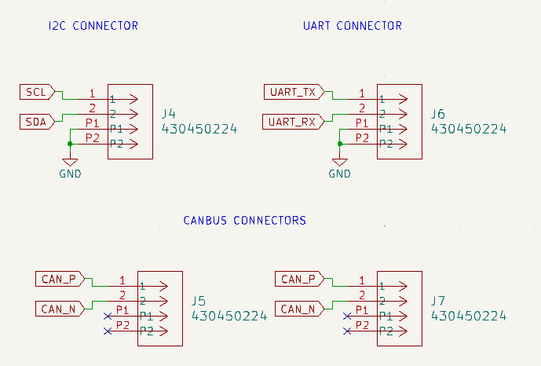

Los conectores I2C, UART y CANBus proveen comunicación en serie para dispositivos integrados con un bus compartido, asíncrona simple y punto a punto y robusta que requiere alta fiabilidady detección de errores.

#### Transceptor CanBus

El transceptor MAX33040E convierte señales digitales del microcontrolador a niveles diferenciales en las líneas CANH y CANL para la comunicación con el bus CAN. Los capacitores de desacoplo filtran ruidos de alta frecuencia y estabilizan la alimentación de +3.3V. Las señales CAN_TX y CAN_RX son las señales convertidas al nivel de la línea CAN. SHDN y STBY ponen en modo apagado o suspendido el transceptor y en modo espera de bajo consumo respectivamente. Las líneas CANH y CANL son las señales resultantes del transceptor tras recibir las señales CAN_TX y CAN_RX. La resistencia R10 evita las reflexiones de la señal CAN. El diodo NUP2105L protector contra sobretensiones protege las líneas contra sobretensiones, picos de voltaje y descargas electroestáticas. Finalmente, el conector de dos pines proporciona las conexiones a las líneas CANH y CANL para su conexión al bus CAN. Los resistores pull-downs R8 y R9 ajustan el comportamiento de las líneas de los datos.

#### Conectores I2C, UART y CanBus

El conector I2C permite la comunicación en serie entre dispositivos en un bus compartido tales como sensores, memorias, pantallas y otros. El conector UART se usa para la comunicación asíncrona en serie entre dispositivos. Finalmente, el conector CANBus se usa para la comunicación en red de dispositivos en tiempo real.

### Página de Potencia

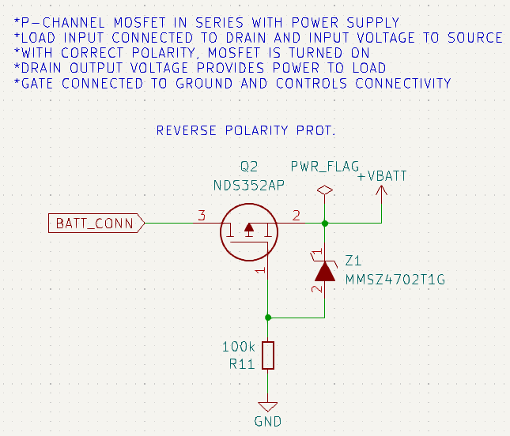

El MOSFET y el diodo Zener forman un circuito para controlar la alimentación de la carga y para la protección contra sobretensiones.

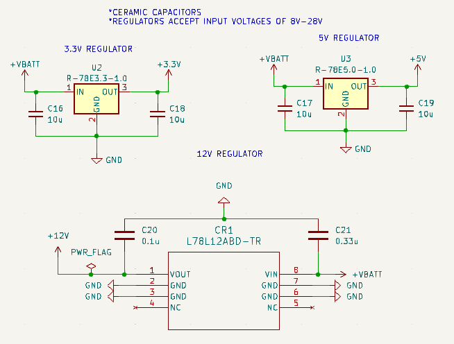

Los reguladores de voltaje garantizan que los dispositivos funcionen de forma segura y eficiente, sus capacitores ayudan a mejorar la estabilidad y rendimiento del sistema.

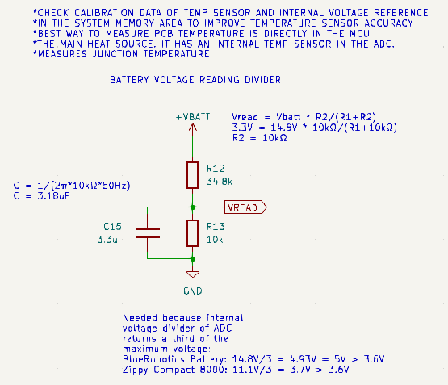

El divisor de voltaje mide el voltaje de la batería para su monitoreo de estado de carga y la garantía de un funcionamiento seguro y eficiente.

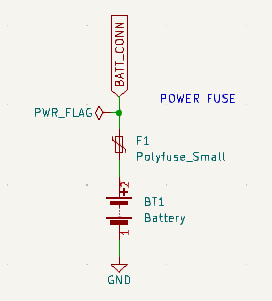

El Power Fuse protege el circuito de sobrecorrientes que podrían dañarlo permanentemente o representar un peligro. La batería se protege a través del fusible.

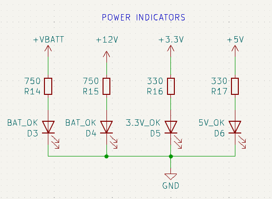

El circuito de indicadores de voltaje sirve para verificar visualmente el estado de las fuentes de alimentación en a PCB. Si una falla o no está presente, el LED correspondiente indica la identificación de problemas en el sistema.

#### Protección contra Sobretensiones

El MOSFET canal-P NDS352AP es conectado en serie con la fuente de alimentación. La carga es conectada al drain (D) y el voltaje de entrada al source (S). El transistor al tener su gate (G) conectada a tierra se polariza en modo conducción para permitir que la corriente fluya desde source hacia el drain para alimentar la carga. Cuando el voltaje en el gate se eleva al nivel de source, se apaga y no pasa corriente. El diodo Zener proporciona una referencia de voltaje y limita este en el gate del MOSFET para conducir y desviar el exceso de voltaje cuando el voltaje supera su voltaje de ruptura inversa. 

#### Reguladores de Voltaje

El regulador de voltaje de +3.3V se utiliza para proveer alimentación al microcontrolador, módulos y sensores y dispositivos adicionales que operan a bajo voltaje de forma estable. El regulador de +5V suministra voltaje apropiado a dispositivos que requieren su potencia moderada. El regulador de +12V se utiliza para el funcionamiento de los motores que requieren más corriente y potencia. Los capacitores asociados en sus entradas y salidas ayudan a filtrar el ruido y fluctuaciones en el voltaje de entrada, suavizan el voltaje de salida reduciendo el rizado debido a la carga variable y mejoran la respuesta transitoria durante momentos de cambios bruscos en la carga.

#### Divisor de Voltaje para Lectura de Voltaje de Batería

El divisor de voltaje en el circuito reduce el voltaje de la batería a un nivel seguro y adecuado para que el microcontrolador pueda medirlo sin riesgo de dañar sus entradas analógicas. Cuando el voltaje de la fuente de alimentación (como en las baterías de BlueRobotics y Zippy Compact 8000 que proporcionan 14.8V y 11.1V) es mayor que el rango máximo permitido de 3.6V ya que al ser divididos por 3 por el divisor de voltaje interno resultan en 4.93V y 3.7V respectivamente.

El divisor de voltaje está compuesto por dos resistencias en serie: Uno de 34.8 kΩ (R1) y otro de 10 kΩ (R2). La fórmula para calcular el voltaje de salida Vout del divisor es:

$$
V_{\text{out}} = V_{\text{in}} \times \frac{R_2}{R_1 + R_2}

$$

Cuando el voltaje de entrada es de 14.8V, el voltaje de salida del divisor es:

$$
V_{\text{out}} = 14.8 \times \frac{10}{34.8 + 10} \approx 3.7 \, \text{V}

$$

Y cuando el voltaje de entrada es de 11.1V:

$$
V_{\text{out}} = 11.1 \times \frac{10}{34.8 + 10} \approx 2.78 \, \text{V}

$$

El capacitor de 3.3 µF conectado a tierra es un filtro que estabiliza la señal de voltaje medida y ayuda a reducir el ruido y las fluctuaciones. 

#### Fusible de Potencia

El fusible de potencia es un elemento de protección frente a sobrecorrientes. Si la corriente que pasa a través del circuito supera el límite seguro, el fusible se “quema”, lo que evita el posible daño a componentes. Si ocurre un cortocircuito, la corriente puede incrementarse rápidamente de manera que el fusible evita el daño excesivo de este con la desconexión automática de la fuente de energía. También, si un componente falla y consume más corriente de lo normal, el fusible corta la alimentación para prevenir que otros en su línea sufran daños por sobrecalentamiento. 

#### Indicadores de Potencia

Los indicadores de voltaje muestran visualmente si las líneas de alimentación VBATT, +12V, +5V y +3.3V están activas y funcionan correctamente. Esto sirve para la depuración y el monitoreo de las fuentes de alimentación. Las resistencias limitan la corriente que pasa a través de los LEDs para protegerlos y evitar que se dañen. La selección de los valores de resistencia asegura que la corriente sea suficiente para iluminar los LEDs sin exceder sus límites de corriente máxima. Cuando reciben corriente, estos indican que la línea de voltaje correspondiente está activa.

### Página de Depuración

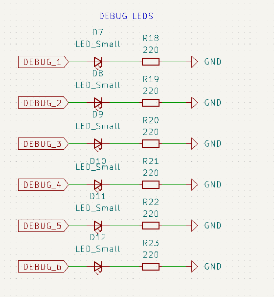

Las resistencias del circuito limitan la corriente para proteger los LEDs. Las señales de depuración se usan para monitorear los estados lógicos del circuito.

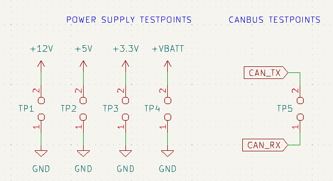

Los puntos de prueba garantizan que el suministro de energía y la comunicación mediante CANBus se estén realizando correctamente.

#### LEDs de Depuración

Los LEDs se iluminan cuando reciben corriente y proporcionan una indicación visual de que la señal de depuración correspondiente está activa. Esta es una forma sencilla y efectiva de verificar el comportamiento del sistema sin instrumentos de medición complejos.

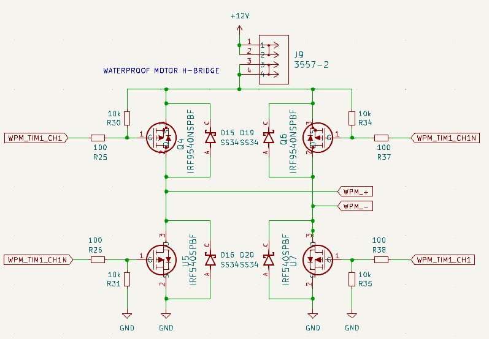

#### Puntos de Prueba de Suministro de Energía y CANBus

Los puntos de prueba para el suministro denergía y CANBus permiten verificar los niveles de voltaje en diferentes etapas del circuito y que los reguladores de voltaje y otras fuentes de energía estén funcionando. El punto de prueba en la línea CANBus permite diagnosticar problemas de comunicación en el bus de datos mediante un osciloscopio o analizador lógico para observar las señales CAN y verificar su integridad.

### Página de Motores

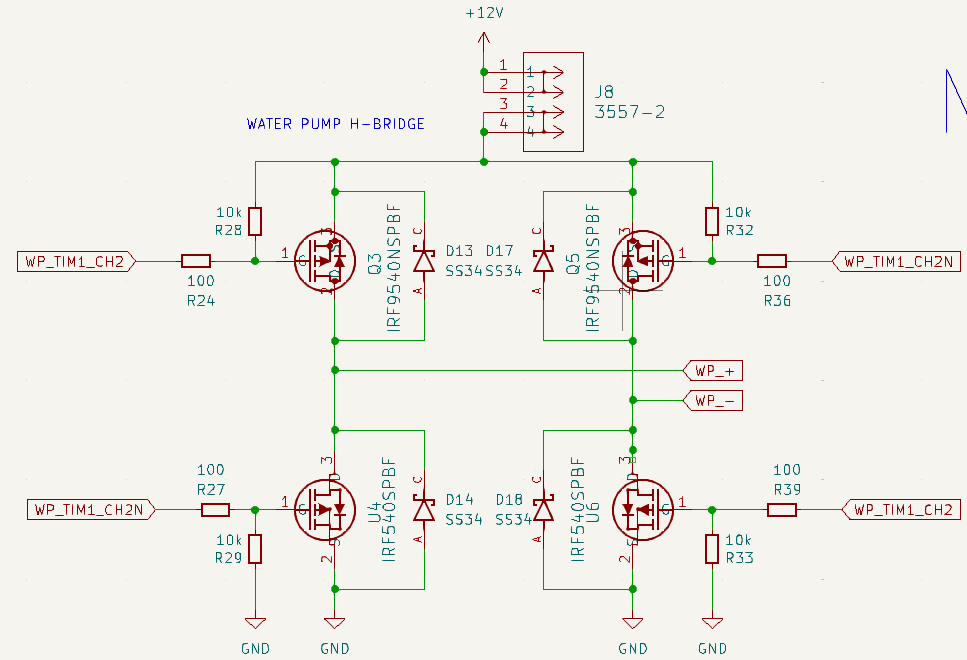

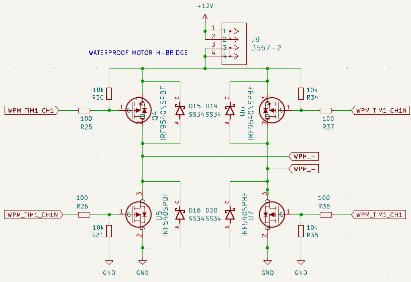

Los puentes-H son dos circuitos electrónicos que accionan la bomba de agua a prueba de agua y un motor a prueba de agua modelo 45-4578 respectivamente. El motor a prueba de agua requiere un voltaje entre 12 y 24 V y una corriente entre 0.5 y 0.6 A y tiene un torque máximo de 140 kg. 

Es imposible asegurar que al pasar de la configuración Q3 y U6 a la configuración Q5 y U4 los transistores se enciendan y apaguen exactamente al mismo tiempo. Si se encienden dos transistores en el mismo lado del puente H, se corre el riesgo de hacer un cortocircuito de la alimentación. De este modo, los diodos SS34 dan un lugar a la corriente cuando los transistores se apagan.

Utiliza 2 transistores IRF9540NSPBF y 2 transistores IRF540SPBF que controlan la dirección de la corriente que circula por el motor. Se requiere que solamente dos transistores se enciendan a la vez para que el motor gire hacia adelante o hacia atrás. Si los transistores IRF9540NSPBF Q3 e IRF540SPBF U6 se encienden, el motor girará en sentido contrario a las agujas del reloj. Si los transistores IRF9540NSPBF Q5 e IRF540SPBF U4 se encienden, el motor girará en sentido de las agujas del reloj. Como un transistor de cada lado del puente estará siempre encendido, siempre habrá un camino continuo para que la corriente fluya a través del motor.

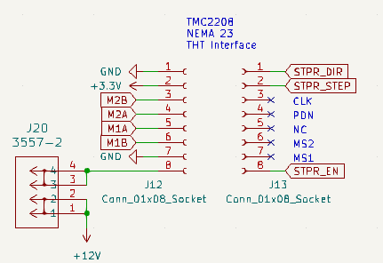

La interfaz THT para el motor de pasos NEMA 23 del mecanismo recoge objetos consiste en conectores 1x8 con una conexión a un fusible 3557-2 como medida protectora del circuito para el arranque del mismo. Esta interfaz permitirá la inserción de un driver de motores de pasos TMC2208 que cuenta con un requerimiento de alimentación de voltaje de 5 a 36 V, con tolerancia de hasta 1.4 A, una S/D y una interfaz UART. Las señales de salida M1A, M1B, M2A y M2BB correspondientes a 2 bobinas de motor de pasos son conectadas a un conector 1x4 que será conectada al NEMA 23.

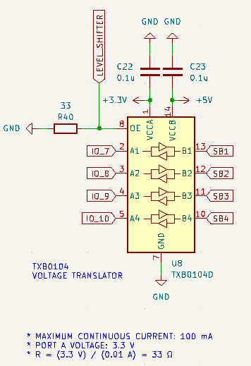

El TXB0104 es un traductor no-inversor de 4 bits que utiliza dos rieles de fuente de alimentación configurables y separados. El puerto A está dedicado al riel Vcca que acepta un voltaje entre 1.2 y 3.6 V. El puerto B está dedicado al riel Vccb que acepta un voltaje entre 1.65 y 5.5V. Esto permite la traducción bi-direccional y universal entre cualquiera de los nodos de voltaje con la consideración de que el riel Vcca no debe exceder el riel Vccb. Requiere una resistencia de 33Ω para ajustar la máxima corriente continua a 100 mA con un voltaje de 3.3V de entrada.

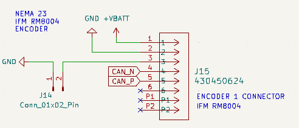

El encóder IFM RM8004 es un encóder absoluto multivuelta con eje hueco usada para la medición de posiciones, velocidades y longitudes con emisión directo de dichos valores mediante una interfaz CANopen. Para su acoplamiento al circuito, se incluyó un conector que suministra una tensión de batería entre 9 y 30 V DC.

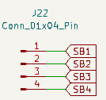

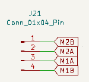

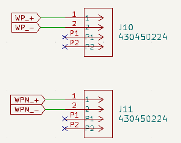

El conector J22 está dedicada al suministro de 4 salidas de +5V provista ´por el traductor TXB0104 para cualquier actuador o módulo externo a la placa de mecanismos.

El conector J21 está dedicada al suministro de las señales a las escobillas del motor NEMA 23 M1A, M1B, M2A y M2B. 

Finalmente los dos conectores J10 y J11 están dedicadas al suministro de las señales WP+ y WP- para la actuación de la carga que es la bomba de agua y las señales WPM+ y WPM- para el motor a prueba de agua modelo 45-4578. Estos conectores son conectores MOLEX 430450224.

### Página de Entradas / Salidas

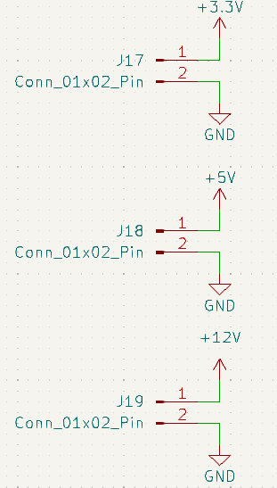

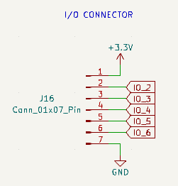

#### Conectores de Salida

Los conector de salida son herramientas usadas en la placa de circuito para una conexión directa con algún módulo, sensor o actuador que requiera uno de los voltajes que proporcionan. Estos son: +3.3V, +5V y +12V. Este tipo de conexiones, sin embargo, no permiten un control flexible y personalizable a diferencia del que un microcontrolador permite.

#### Conector de Entradas / Salidas de +3.3V

El conector de entradas y salidas de +3.3V con 5 entradas / salidas es otro instrumento adicional encontrada en la placa de circuitos para la conexión directa al microcontrolador con sensores, módulos y actuadores que requieren un voltaje de alimentación de +3.3V.

## Diseño de PCB

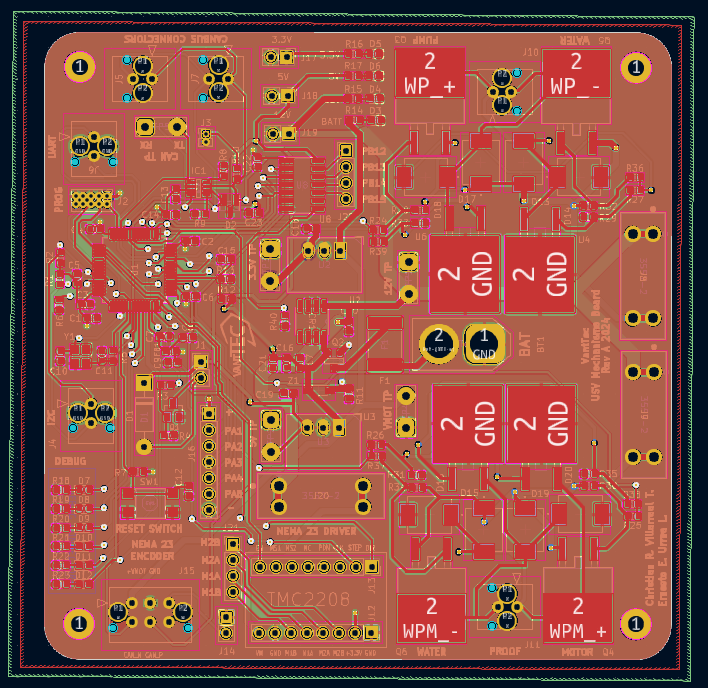

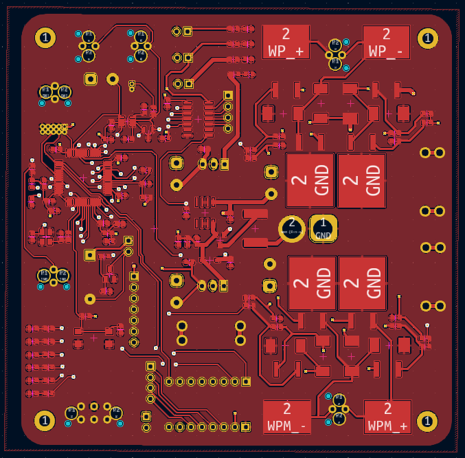

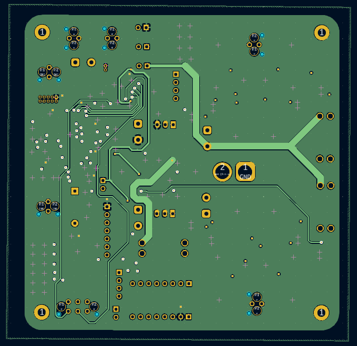

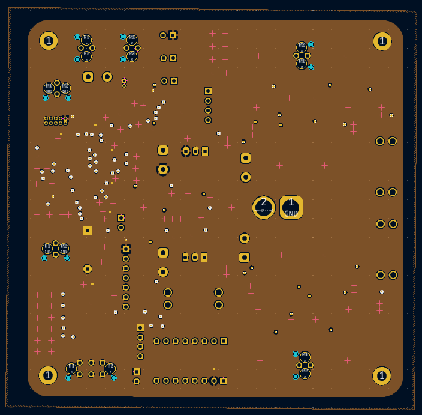

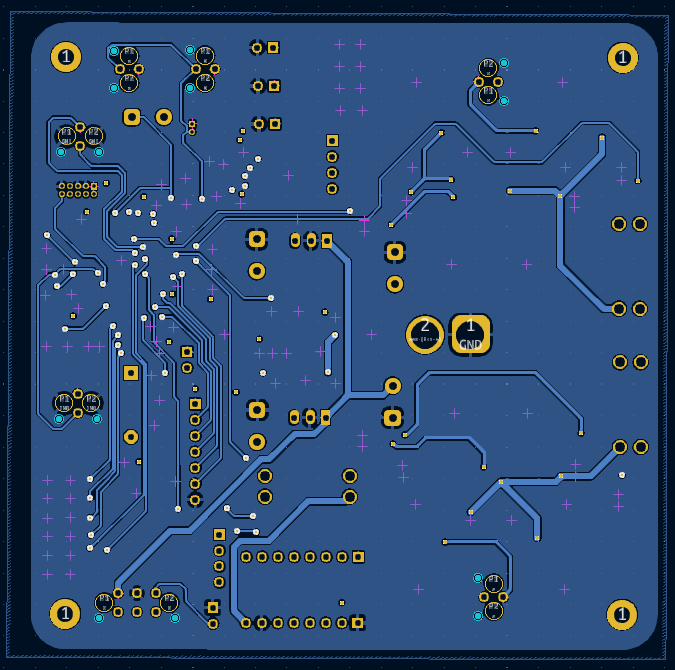

## Bill of Materials

[https://docs.google.com/spreadsheets/d/1SJM0K_JLoy-SFYojY3FOc_8aMb5Lb9OaPbiezuwVjZs/edit?usp=sharing](https://docs.google.com/spreadsheets/d/1SJM0K_JLoy-SFYojY3FOc_8aMb5Lb9OaPbiezuwVjZs/edit?usp=sharing)

[PCB REVA USV BOM - JLCPCB.xlsx](images/documentacion_chrips/PCB_REVA_USV_BOM_-_JLCPCB.xlsx)

[PCB REVA USV BOM - MOUSER.xlsx](images/documentacion_chrips/PCB_REVA_USV_BOM_-_MOUSER.xlsx)

## Proyecto RevA 2024 Mecanismos

[https://github.com/vanttec/usv_mecanismos_pcb.git](https://github.com/vanttec/usv_mecanismos_pcb.git)

