# PCB RevB 2022 STM32

> Diseñada por Abiel Fernández Cantú
> 

La placa RevB STM32 2022 es una placa de circuitos impresa que tiene el propósito de 

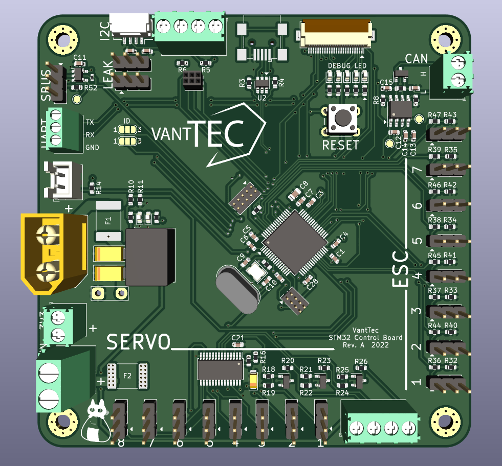

## Diseño de Esquemático

### Página de Raíz

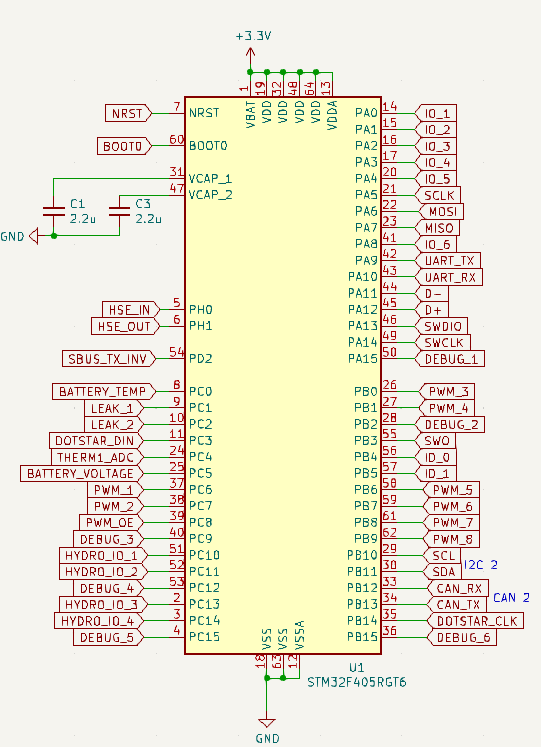

STM32F405RGT6 con etiquetas globales y banderas de potencia. Permite la comunicación mediante protocolos de comunicación como UART, SPI, I2C y CAN.

El conector programado es esencial para la programación y depuración del microcontrolador para facilitar la comunicación, control y reinicio. El pin BOOT0 garantiza que el microcontrolador arranque desde la memoria flash interna. El switch de reinicio garantiza un reinicio limpio y estable.

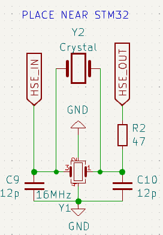

El oscilador de 16 MHz le da al microcontrolador una fuente de reloj externa precisa para mejorar su rendimiento.

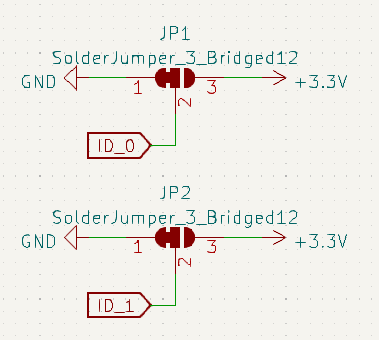

Los puentes de soldadura permiten al usuario seleccionar entre dos opciones para los pines conectados: GND o 3.3V. Pueden proveer direcciones a periféricos o seleccionar el modo de operación del microcontrolador.

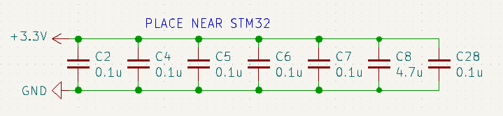

Los capacitores / condensadores de desacoplamiento o bypass colocados cerca de la STM32 utilizados para reducir el ruido y ayudar a crear una señal de corriente continua más limpia y proporcionar energía adecuada.

El root page del proyecto contiene los elementos básicos requeridos por el microcontrolador STM32F405RGT6 de la placa impresa de circuitos.

#### STM32F405RGT6

El microcontrolador en la placa de circuitos RevB 2022 STM32 tiene el papel de cerebro del sistema. Se encarga de ejecutar las instrucciones en su memoria para controlar el funcionamiento de los dispositivos y circuitos conectados a la PCB.

#### Capacitores / Condensadores de Desacoplamiento o Bypass

Los capacitores / condensadores de desacoplamiento o bypass se colocan cerca de los pines fuentes de energía del microcontrolador para actuar como reservas locales de energía. Cuando el microcontrolador cambia estados rápidamente (e.g., durante procesamiento o comunicación), los cambios repentinos en la extracción de corriente pueden crear fluctuaciones de voltaje en las líneas eléctricas. Los capacitores proveen corriente instantánea para suavizar estas fluctuaciones y mantener un voltaje estable. Los capacitores de 0.1 µF se usan para el desacoplamiento de frecuencias altas y el de 4.7 µF para manejar ruido de baja frecuencia y capacitancia masiva.

Los capacitores conectados a las líneas VCAP_1 y VCAP_2 estabilizan la alimentación interna del núcleo del microcontrolador. Estos pines están asociados al regulador interno del microcontrolador que convierte la alimentación en un voltaje más bajo necesario para operar el núcleo.

#### Oscilador de 16 MHz

El oscilador de 16 MHz proporciona una señal de reloj precisa y estable para el microcontrolador cuando es excitado eléctricamente. Esta señal es necesaria para sincronizar todas las operaciones internas, como la ejecución de instrucciones y la comunicación de periféricos. Aunque algunos microcontroladores tienen osciladores internos, los externos tienen mayor precisión y menor desviación de frecuencia. Los capacitores conectados ayudan a estabilizar la oscilación y ajustar la frecuencia del cristal para mantener su frecuencia nominal. También tiene una resistencia para ajustar su ganancia y asegurar un inicio confiable de su oscilación. 

#### Conector Programador

El conector programador (PROG) sirve para conectar un programador externo (como un ST-LINK) al microcontrolador. Contiene pines como SWCLK (Serial Wire Clock), SWDIO (Serial Wire Data Input / Output), RESET (NRST), VTREF (Voltaje de Referencia) y GNDDetect para la señal de reloj para la comunicación, la línea de datos bidireccional para la comunicación SWD, el reinicio del microcontrolador, la indicación al programador del nivel lógico del microcontrolador y el establecimiento de la referencia del circuito.

#### Botón de Reinicio

El botón de reinicio permite reiniciar manualmente el microcontrolador al ser presionado, ya que conecta el pin NRST (Reset) directamente a tierra (GND). La resistencia entre ambas piezas actúa como un pull-up, manteniendo el pin NRST en un nivel lógico alto por defecto lo que evita reinicios no deseados debido a ruido eléctrico.

#### Señal de Boot

BOOT0 es un pin de configuración que determina el modo de arranque del microcontrolador. Está conectado a tierra mediante un resistor para que el microcontrolador arranque desde la memoria flash interna en donde se encuentra el firmware programado. Si se conecta a nivel alto (e.g. +3.3V), el microcontrolador arranque en un modo alternativo, como el arranque de la memoria del sistema (bootloader) donde se puede cargar firmware nuevo sin un programador externo. De forma predeterminada, el resistor es un pull-down para que BOOT0 esté en un nivel bajo y la STM32 arranque desde su memoria flash.

#### Puentes de Soldadura

Los puentes de soldadura permiten al usuario seleccionar entre dos opciones para el pin conectado: ID_0 e ID_1. El pin correspondiente ID_0 o ID_1 es establecido a un nivel lógico bajo (0) al conectarse a tierra (GND) y a un nivel lógico alto (1) si es conectado a 3.3V. Estos puentes pueden usarse para proveer direcciones a múltiples periféricos en una red de comunicaciones o en un bus como I2C, SPI o UART. También sirven para la selección de modo del microcontrolador como modo debug, bootloader o de operación normal.

### Página de I/O

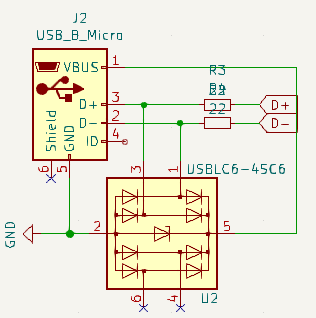

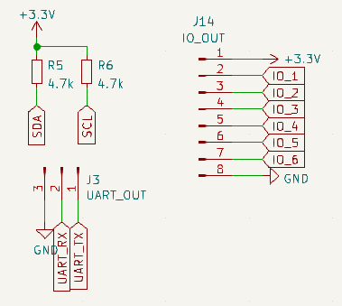

### Página Comms

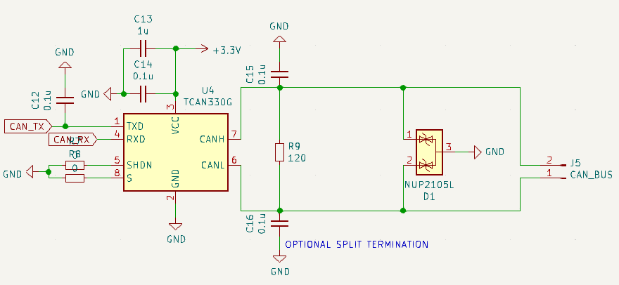

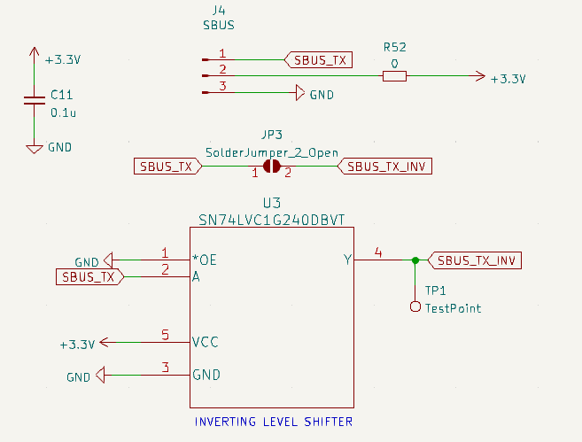

### Página de Alimentación

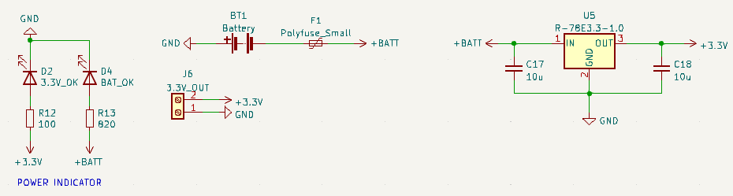

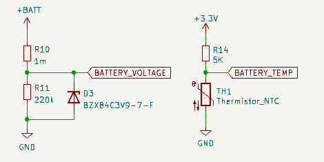

### Página de Sensores

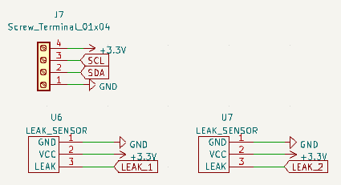

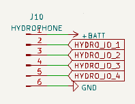

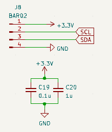

### Página de PWM

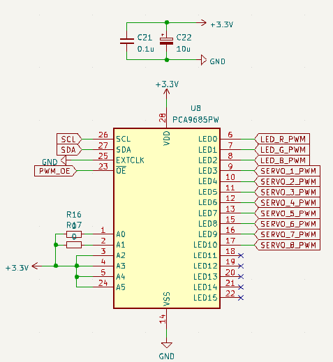

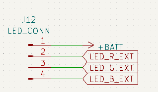

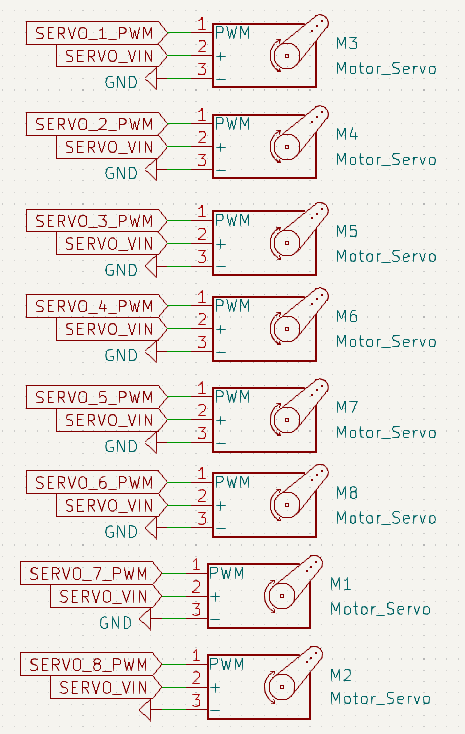

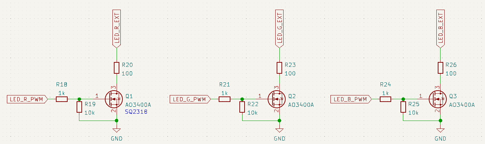

### Página de Debug

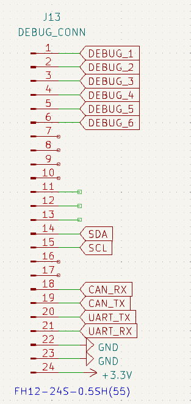

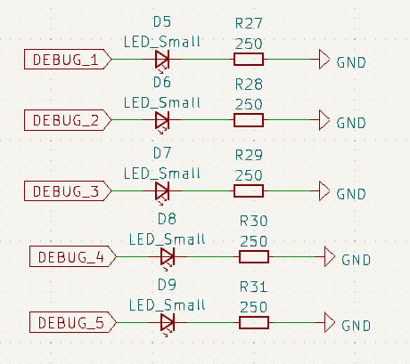

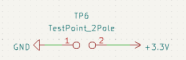

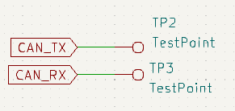

### Página de Motores

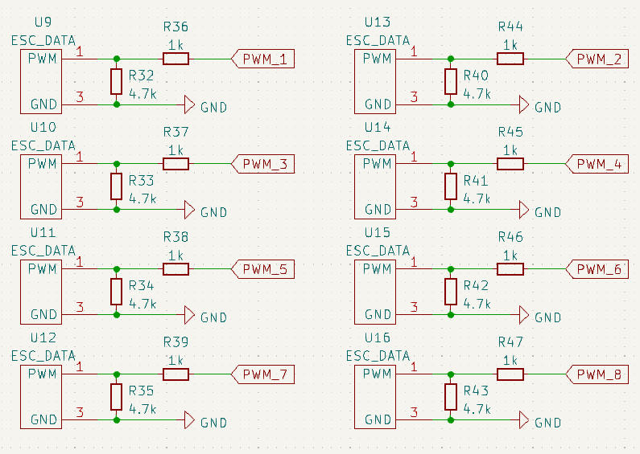

## Diseño de PCB

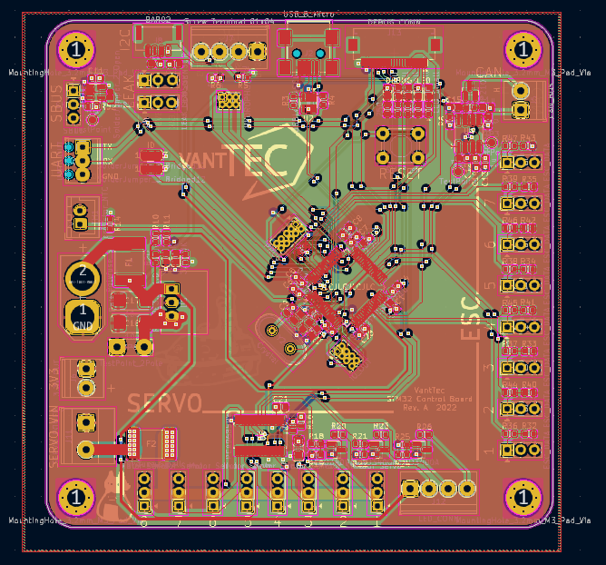

## Proyecto RevB 2022 STM32

[https://github.com/vanttec/stm-revb-pcb.git](https://github.com/vanttec/stm-revb-pcb.git)

El proyecto en Github contiene todos los archivos necesarios para su inspección, rediseño y manufactura como:

- Los diseños esquemático y de PCB
- Archivos DRL y Gerber
- Archivo CPL
- Bill of Materials